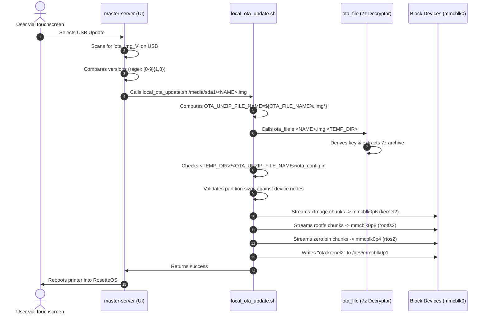

# CrealityOS OTA Packaging & Update Subsystem Specification

This document provides a technical specification of Creality's Over-The-Air (OTA) firmware update container format, encryption model, payload chunking, and the on-device update execution engine used across the **Ender-3 V3 KE** (board target `F005`) and the **Nebula Smart Kit / Nebula Pad** (board target `NEBULA`).

---

## 1. Overview & Security Model

Creality's local (USB) and network OTA update mechanism on Ingenic X2000 devices is **integrity-checked but unauthenticated**:

* **Archive Envelope**: A password-protected 7z archive with encrypted headers (`-mhe=on`).
* **Encryption Key**: Derived deterministically from the hardware board name using standard Unix MD5 crypt.
* **Payload Verification**: Each sub-payload (`xImage`, `rootfs.squashfs`, `zero.bin`) is checked using MD5 checksums.
* **No Cryptographic Signatures**: The device does **not** enforce RSA digital signatures or public key verification during OTA updates. Unsigned custom kernels and root filesystems flash and boot cleanly through stock firmware.

---

## 2. Key Derivation Formula

The 7z archive password is generated per board type using standard Unix MD5 password encryption (`$1$` format) with a hardcoded salt:

$$\text{Password} = \text{MD5-Crypt}(\text{Key} = \text{BOARD\_NAME} + \text{"C3\_7e\_bz"}, \text{Salt} = \text{"cxswfile"})$$

In shell (using `openssl`):
```bash
openssl passwd -1 -salt cxswfile "${BOARD_NAME}C3_7e_bz"
```

### Known Board Encryption Keys

| Target Device | Board Identifier | Input String | Resulting 7z Password |
| :--- | :--- | :--- | :--- |
| **Ender-3 V3 KE** | `F005` | `F005C3_7e_bz` | `$1$cxswfile$ZFd0RWFYkJQugbtKVGL9y0` |
| **Nebula Pad** | `NEBULA` | `NEBULAC3_7e_bz` | `$1$cxswfile$XG7ANbYX3bq2H2xmmwrka.` |
| **Creality K1** | `CR4CU220812S12` | `CR4CU220812S12C3_7e_bz` | Board-derived key |

> [!TIP]
> `tools/pack_rosetteos.py` includes a pure-Python implementation of Unix MD5-crypt, making password derivation completely cross-platform without external tools.

---

## 3. Archive Structure & Layout

Creality's update extractor (`/etc/ota_bin/local_ota_update.sh`) has strict structural expectations.

### Directory Hierarchy

For an archive file named `<ARCHIVE_STEM>.img` with package version `<VERSION>` (e.g. `NEBULA_ota_img_V1.1.0.34.img` with version `1.1.0.34`):

```
<ARCHIVE_STEM>/                               # Top-level directory inside 7z
├── ota_config.in                             # Root version pointer
└── ota_v<VERSION>/                           # Versioned payload folder
    ├── ota_v<VERSION>.ok                     # Readiness marker (touch file)
    ├── ota_update.in                         # Primary payload manifest
    ├── ota_md5_xImage.<FULL_MD5>             # Chunk MD5 sidecar for kernel
    ├── ota_md5_rootfs.squashfs.<FULL_MD5>    # Chunk MD5 sidecar for rootfs
    ├── ota_md5_zero.bin.<FULL_MD5>           # Chunk MD5 sidecar for RTOS
    ├── xImage.0000.<FULL_MD5>                # 1 MiB chunk 0
    ├── xImage.0001.<CHUNK0_MD5>              # 1 MiB chunk 1
    ├── ...
    ├── rootfs.squashfs.0000.<FULL_MD5>
    ├── ...
    └── zero.bin.0000.<FULL_MD5>
```

---

## 4. Manifest Formats

### 1. `ota_config.in`
Located at the root of the extracted folder:
```ini
current_version=1.1.0.34
```

### 2. `ota_v<VERSION>.ok`
An empty 0-byte or 1-byte newline file placed in `ota_v<VERSION>/`. If missing, the updater aborts.

### 3. `ota_update.in`
Lists each payload with its partition type, internal filename, byte size, and full-file MD5:
```ini
ota_version=1.1.0.34

img_type=kernel
img_name=xImage
img_size=5541952
img_md5=f3bf93ad2fd1e770dacb3062ba9cf05c

img_type=rootfs
img_name=rootfs.squashfs
img_size=346923008
img_md5=7d0d3742dedd7a236632e4f7439f52dd

img_type=rtos
img_name=zero.bin
img_size=424264
img_md5=8e852ae9b8f5b78f3818e4236c3e8f1d
```

### 4. Sidecar Checksum Files (`ota_md5_<NAME>.<FULL_MD5>`)
Text files containing the MD5 checksum of each 1 MiB chunk in order, separated by newlines:
```
e10adc3949ba59abbe56e057f20f883e
c33367701511b4f6020ec61ded352059
...
```

---

## 5. Payload Slicing & Chunking Algorithm

Creality splits large image files into fixed **1 MiB** (1,048,576 bytes) chunks to manage RAM constraints on the 208MB-RAM device during download and flashing:

1. **Chunk Naming Convention**:
   $$\text{chunk\_filename} = \text{base\_name} + \text{"."} + \text{index:04d} + \text{"."} + \text{prev\_md5}$$
2. **First Chunk (`index = 0000`)**:
   `prev_md5` is set to the **FULL MD5** of the unchunked source file.
3. **Subsequent Chunks (`index > 0000`)**:
   `prev_md5` is the MD5 checksum of the **immediately preceding chunk** (`index - 1`).
4. **Final Chunk**:
   Carries the remaining bytes ($\le 1,048,576$ bytes).

---

## 6. On-Device Update Execution Flow

Understanding the device-side execution path in `/etc/ota_bin/local_ota_update.sh` explains the strict naming rules:



### The Critical Folder-Name Matching Rule

Lines 312–320 of `local_ota_update.sh`:
```bash
OTA_FILE_NAME=$(basename ${OTA_FILE})
OTA_UNZIP_FILE_NAME=${OTA_FILE_NAME%.img*}
ota_site=${OTA_FILE_PATH}/${OTA_UNZIP_FILE_NAME}
/usr/bin/ota_file e ${OTA_FILE_PATH}/${OTA_FILE_NAME} ${OTA_FILE_PATH}
ota_site_config=$ota_site/ota_config.in
```

> [!IMPORTANT]
> If the archive file is named `NEBULA_ota_img_V1.1.0.34.img`, `OTA_UNZIP_FILE_NAME` evaluates to `NEBULA_ota_img_V1.1.0.34`. The root directory inside the 7z archive **must match that exact string**. If the archive has a different folder name, `cp -f $ota_site_config` fails and the update aborts immediately.
